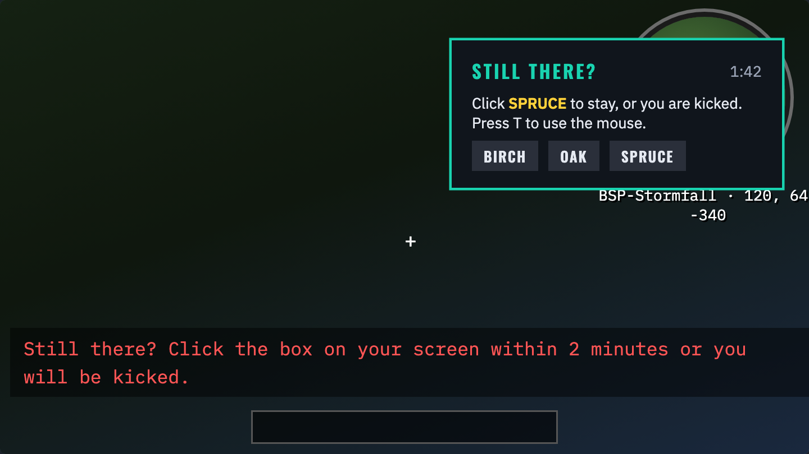
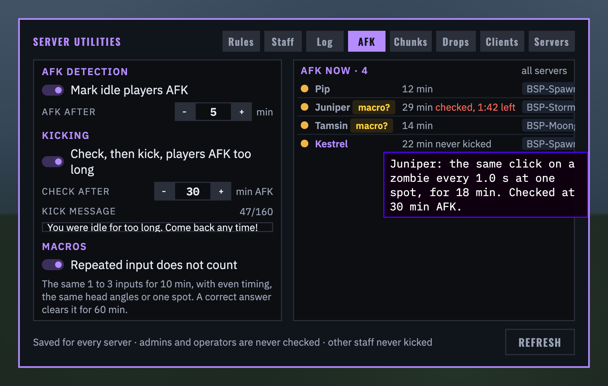
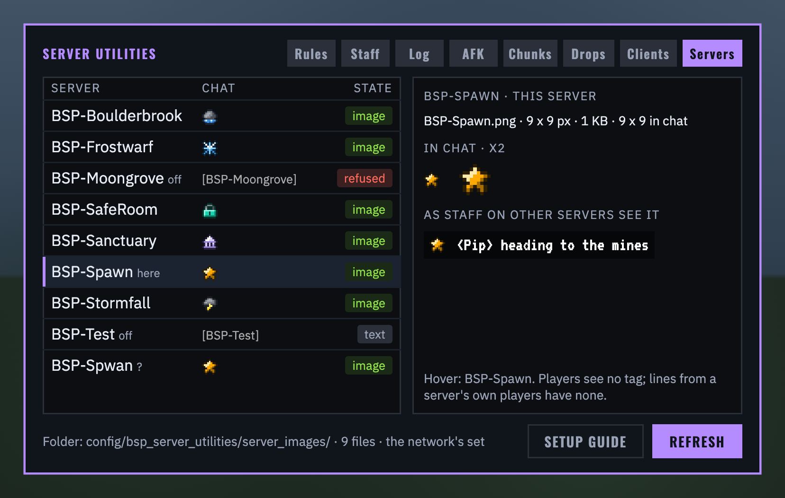

# BSP-Server Utilities 0.7.0: still there? The presence check, and macros caught

For Minecraft 1.20.1, Forge 47.4 or newer. **Clients and servers both need 0.7.0**: the network protocol changed, so a 0.6 client is refused by a 0.7 server (and the other way round). Works on its own; uses **BSP-Core 1.4.0** or newer (tested with 1.6.2), **LuckPerms**, **BSP-InventorySync** and **BSP-Velocity Additions** when they are installed. Coming from 0.5.x, server images in chat from 0.6.0 are new to you too: see below and the description.

## New in 0.7.0: the presence check

- **No kick without a check:** with AFK kicking on, a player AFK for the kick time (30 minutes to begin with) gets a "STILL THERE?" card instead of a kick: two minutes on the clock, "Click SPRUCE to stay, or you are kicked." and three keys in a random order. The word is one of the eight woods (Oak, Spruce, Birch, Jungle, Acacia, Dark oak, Mangrove, Cherry), new each check. A red chat line says the card is there, and the warning a minute before now reads "You will be checked for being idle in 1 minute."
- **Answering:** the right key brings them back ("Thanks, you are back."). A wrong one gives a new word and a new order ("Not that one: here is a new word."), with the clock still running. No answer in two minutes kicks them with the kick message, as before. The server picks the word and checks the answer, so a client cannot answer for itself.
- **Where it shows:** somewhere new on the screen each check, never over the hotbar or the crosshair, and drawn over everything: chat, other mods' HUDs (JourneyMap's minimap included) and any open screen, where it is clicked directly. With no screen open, T opens chat to use the mouse.
- **Who is checked:** everyone except admins and operators. Other staff are checked but never kicked: not answering leaves them AFK (away on the staff panels) until they are back.
- **Kicking off:** no checks and no kicks, as before.

## New in 0.7.0: macros do not count

- The server watches each player's last ten minutes of input: what they did and to what, their head's angles, and where they stood. When the same 1 to 3 inputs make 90 % or more of it, and at least one of these holds, it is taken for a macro:
  - even timing: the gaps hardly vary, where a person's vary 20 % or more;
  - the same exact head angles again and again;
  - staying within 8 blocks.
- While that holds, the macro's own clicks and head turns no longer count as activity. The player goes AFK after the AFK minutes and gets the check at the kick time like anyone idle. Anything else they do (chat, a real look around, walking off) still counts.
- A correct answer makes their input count again for an hour.
- The AFK tab's new **MACROS** switch, "Repeated input does not count", is on to begin with and saved for every server.
- In the AFK list a gold **macro?** mark sits beside such players; hovering it shows what was seen ("the same click on a zombie every 1.0 s at one spot, for 18 min"). During a check the row counts down ("checked, 1:42 left").
- Every unanswered check is written to the action log by "AFK check", with what was seen. These entries are for staff only (the LOG tab's kind "AFK checks"), never on panels, `/actionlog` or the board.

## New in 0.7.0: AFK players' chunks unload

- A player who is AFK counts as away for chunk unloading: their machines' chunks unload after the chunk minutes (5 to begin with) even while they stay online, and load again the moment they are active. The CHUNKS tab shows them as "AFK 12 min". So AFK pools and macros no longer keep a base's chunks loaded all night.

## Changed in 0.7.0
- The network protocol is version 5: update clients and servers together.
- The AFK settings in shared storage get a `macros` column, added at the first start (on for the network).
- `/su status` says whether repeated input counts.

## New in 0.6.0: server images in chat

- One small PNG per server (in `config/bsp_server_utilities/server_images/`, named as Velocity knows the server, `BSP-Spawn.png`) takes the place of the grey `[BSP-Spawn]` tag in chat, one line high.
- They show in the player counter's welcome on the other servers, and in relayed chat for staff with BSP-Velocity Additions (`<server_tag>` in its `messages.toml`).
- REFRESH on the new SERVERS tab, the eighth, makes one server's folder the network's set. It asks SURE? before it replaces or removes an image in use, and each refresh goes in the action log. `/su serverimages` does the same from chat.
- Files must be PNGs, not animated, at most 512 x 64 pixels and 256 KB, and at most 96 pixels wide in chat. A server without an image keeps its grey name.
- The setup guide has a Server images page.
